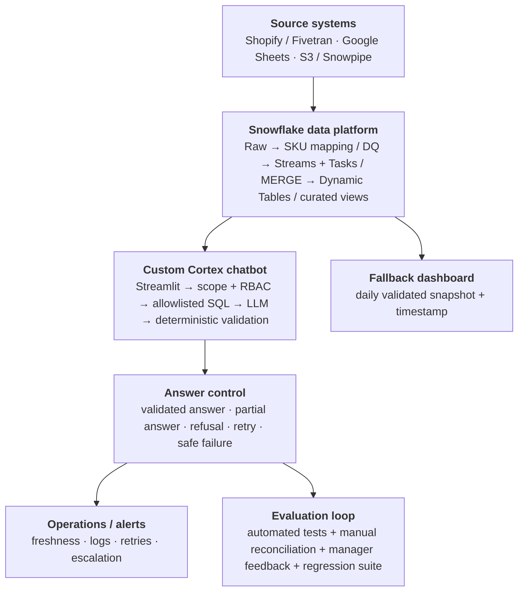

# ZAAR | AI Operations Assistant

A production-planning chatbot that **explains approved numbers instead of inventing them**.

ZAAR sells medical apparel through B2B (hospitals) and retail channels. Each planning cycle, the **production manager** needs to know how many finished goods to make, and the **supply manager** needs to know how much material to reorder. I built the data pipeline and the chatbot behind those answers on Snowflake (Streams, Tasks, Dynamic Tables, Cortex, Streamlit).

> **About this repo.** The real system runs on Snowflake with confidential business data, so it can't be published. This repo is a **runnable prototype of the same design**: every number is synthetic, Snowflake is replaced by a local `sqlite` database, and the LLM is replaced by a deterministic stand-in so the evaluation is reproducible with zero credentials. The SQL in [`sql/`](sql) is Snowflake-dialect and illustrative (it is not executed here). The original design document is in [`docs/system_design.pdf`](docs/system_design.pdf).

**What to look at**

| If you want to see… | Go to |
|---|---|
| Business context | [§1](#1-business-objective-and-system-boundaries) |
| System design (pipeline, calculations, architecture) | [§2–§6](#2-end-to-end-data-pipeline) and [`sql/`](sql) |
| The chatbot | [`src/zaar_assistant/`](src/zaar_assistant) |
| How it is evaluated | [§8–§9](#8-reliability-improvement-story) and [`eval/`](eval) |

---

## 1. Business objective and system boundaries

- **Production manager:** needs next-cycle finished-goods production quantities.
- **Supply manager:** needs material reorder quantities.
- **The chatbot's job:** *explain approved results.* It does **not** invent forecasts or independently decide production plans. All numbers come from deterministic SQL; the LLM only chooses which approved lookup to run and phrases the result.

That boundary is the core design decision: in an operations setting a fluent wrong number is worse than no answer, so the system is built to **fail closed**.

## 2. End-to-end data pipeline

| Stage | Implementation and engineering controls |
|---|---|
| **Ingest** | Shopify orders/cancellations via Fivetran; hospital B2B orders via scheduled Google Sheets ingestion; retailer/vendor files via S3 + Snowpipe. Land immutable raw records with source IDs, ingestion time and batch IDs. |
| **Standardize** | Map source product identifiers to canonical SKUs; normalize units; deduplicate by source order/line ID; quarantine unmapped SKUs and malformed records. |
| **Process changes** | Snowflake Streams identify changed rows; Tasks run idempotent `MERGE` updates for cancellations, returns and corrected orders; alert on failed jobs and reconcile record counts. |
| **Calculate** | Dynamic Tables refresh curated inventory and replenishment views at defined freshness targets; demand forecasts, BOM, batch sizes, capacity and lead times feed deterministic SQL. |
| **Serve** | Read-only production and supply views expose quantities, SKU/material, cycle, units, record ID, source version and calculation timestamp. A daily validated snapshot feeds an independent fallback dashboard. |

Code: [`sql/01_raw_and_sku_mapping.sql`](sql/01_raw_and_sku_mapping.sql) · [`02_streams_tasks_merge.sql`](sql/02_streams_tasks_merge.sql) · [`03_dynamic_tables.sql`](sql/03_dynamic_tables.sql) · [`04_planning_views.sql`](sql/04_planning_views.sql)

## 3. Deterministic planning calculations

```
net finished-goods requirement = max(0, forecast demand + safety stock − available stock − scheduled receipts)
executable production          = round net UP to a valid batch size, capped by capacity (whole batches);
                                 if capacity is insufficient → flag a planning exception, never silently change it
material reorder               = max(0, planned production × BOM usage + material safety stock
                                        − available material − scheduled receipts)
                                 → rounded up to supplier pack size, at least the minimum order quantity
```

**Worked example (synthetic):** 500 demand + 100 safety − 180 on hand − 50 incoming = **370** net units → rounded up to **400** with 100-unit batches. Implemented in [`planning.py`](src/zaar_assistant/planning.py) (Python mirror of the SQL) and pinned by a test in [`tests/test_planning.py`](tests/test_planning.py). This exact example is also the story of iteration V4 below.

## 4. Architecture

**At a glance**



Solid arrows are the primary data/answer flow. The dashboard is a **parallel fallback**, not a downstream chatbot output: if the chatbot is down or blocked, managers still have a validated snapshot.

**Detailed component architecture**: sources, ingestion, the three Snowflake schemas, the assistant's internal stages, and where the fallback dashboard and evaluation loop attach.

```mermaid
flowchart LR
    subgraph SRC["Source systems"]
        direction TB
        S1["Shopify<br/>orders · cancellations"]
        S2["Hospital B2B orders<br/>Google Sheets"]
        S3["Retailer / vendor files<br/>S3 bucket"]
        S4["Planning inputs<br/>demand forecast · BOM<br/>batch sizes · capacity · lead times"]
    end

    subgraph ING["Ingestion"]
        direction TB
        I1["Fivetran"]
        I2["Scheduled Sheets load"]
        I3["Snowpipe"]
    end

    subgraph SF["Snowflake data platform"]
        direction TB
        RAW[("RAW schema<br/>immutable landing<br/>source IDs · ingested_at · batch_id")]
        MAP["SKU standardization<br/>canonical SKU map · dedup<br/>unit normalization"]
        QUA[("QUARANTINE<br/>unmapped SKUs<br/>malformed records")]
        CHG["Change processing<br/>Streams + Tasks<br/>idempotent MERGE"]
        CUR[("CURATED schema<br/>Dynamic Tables<br/>inventory · replenishment")]
        SERVE[("SERVE schema<br/>read-only views<br/>production_plan · material_reorder")]
        RAW --> MAP --> CHG --> CUR --> SERVE
        MAP -. rejects .-> QUA
    end

    subgraph APP["Assistant application"]
        direction TB
        UI["Streamlit UI<br/>question + authenticated user"]
        PRE["Pre-retrieval controls<br/>authenticate · authorize role<br/>scope class · normalize SKU/period"]
        LLM["Cortex LLM<br/>selects a tool + parameters<br/>and phrases the result"]
        REG["Tool registry<br/>3 allowlisted read-only tools<br/>server-side param validation"]
        GATE["Post-generation validator<br/>claim ↔ record check<br/>qualifiers · freshness"]
        ANS["Answer control<br/>answer · partial · refuse<br/>clarify · safe failure"]
        UI --> PRE --> LLM --> REG
        REG --> LLM
        LLM --> GATE --> ANS --> UI
    end

    DASH["Fallback dashboard<br/>daily validated snapshot<br/>+ as-of timestamp"]

    subgraph OBS["Operations and quality"]
        direction TB
        OPS["Alerts and logs<br/>job failures · freshness SLA<br/>retries · escalation"]
        EVAL["Evaluation loop<br/>automated tests · manual reconciliation<br/>manager feedback · regression suite"]
    end

    S1 --> I1 --> RAW
    S2 --> I2 --> RAW
    S3 --> I3 --> RAW
    S4 --> CUR
    SERVE -- "SELECT only<br/>(role-scoped)" --> REG
    SERVE -- "daily snapshot" --> DASH
    ANS --> OPS
    CHG --> OPS
    ANS --> EVAL
    EVAL -. "new regression cases<br/>logic fixes" .-> CUR
```



More views in [`docs/architecture.md`](docs/architecture.md): the **request lifecycle** (sequence diagram showing every point where a question can be refused, retried or blocked), the **data model** (entity-relationship diagram) and the **trust boundaries and role access** table.

## 5. Controlled retrieval and request-time controls

Streamlit collects the question and the authenticated user context. The model **never gets arbitrary SQL execution rights**:

- It can only select among **allowlisted, parameterized, read-only tools**: `get_production_plan`, `get_inventory_status`, `get_material_reorder` ([`tools.py`](src/zaar_assistant/tools.py)).
- The **server** validates parameters (known SKU / material / cycle) and enforces role-based access *before* touching data. A production manager asking a supply question is refused, with no data leaked.
- Tools return **structured evidence**: metric, SKU/material, cycle, unit, record ID, source timestamp.

**Before retrieval** ([`router.py`](src/zaar_assistant/router.py)): authenticate → authorize role and data domain → classify the request as fully in-scope / mixed / out-of-scope → normalize SKU and period → reject invalid parameters (including prompt-injection / raw-SQL attempts).

**After generation** ([`validator.py`](src/zaar_assistant/validator.py)): deterministic Python checks **each numerical claim against the exact metric + SKU/material + cycle + unit + source record**, not merely whether the number appears somewhere in the results. It also checks that mandatory qualifiers are present (e.g. a capacity exception can't be dropped). Only validated answers are displayed.

A correct number attached to the wrong SKU or period is still a wrong answer; this is the failure mode the validator is designed around (see [`test_validator.py`](tests/test_validator.py)).

## 6. Failure handling, access and observability

| Condition | Safe behavior | Where |
|---|---|---|
| Bad/missing SKU or unauthorized scope | Ask for clarification or refuse; no cross-role data leakage | `router.py`, `tools.py` |
| Query timeout / transient tool error | Bounded retry with backoff (2 attempts), then safe failure; never invent values | `controls.with_retry` |
| Validation mismatch / validator exception | Block the answer; one controlled regeneration if evidence is valid, otherwise fail closed and log an alert | `answer.py` |
| Stale inputs / broken upstream job | Freshness SLA (< 24h for daily planning); show timestamp and block the recommendation if breached | `controls.stale_records` |
| Dashboard fallback | Last successfully validated snapshot, with as-of time and staleness warning; escalate if outside the decision-safe window | `sql/03_dynamic_tables.sql` |

## 7. The chatbot in action

Synthetic outputs from this repo (`production_manager` unless noted):

```text
Q: How many scrub tops should we produce next cycle?
A: SCR-TOP-001 (2026-C12): net requirement 370 units, planned production 400 units. [INV-0001+FC-0001]
   Source data as of 2026-11-15T05:00:00.

Q: How many scrub pants should we make this cycle?
A: SCR-PNT-001 (2026-C12): net requirement 550 units, planned production 500 units. Capacity exception:
   the batch-rounded requirement exceeds cycle capacity by 100 units, so planned production is capped at 500 units. [INV-0002+FC-0002]

Q: How many scrub tops should we produce, and what will demand be in 2027?      ← mixed → partial answer
A: SCR-TOP-001 (2026-C12): net requirement 370 units, planned production 400 units. [INV-0001+FC-0001]
   Not covered: new demand forecasts or predictions are outside this assistant's scope (it explains approved results only).

Q: How much BTN-STD should we order?                                             ← wrong role
A: You don't have access to that data domain with your current role.
```

## 8. Reliability improvement story

Four iterations, each driven by a failure the previous version could not see:

**V1: Automated source reconciliation.** Source-grounding from day one: every generated quantity had to match the retrieved Snowflake record on metric, SKU, cycle and unit; unsupported claims were blocked before display. Tests deliberately swapped SKUs, periods and units. → [`validator.py`](src/zaar_assistant/validator.py), the `swap_*` cases in [`eval/failure_injection.py`](eval/failure_injection.py)

**V2: Manual evaluation and error discovery.** Built a ~30-question evaluation set and compared answers by hand with the authoritative Snowflake tables. Manual review exposed problems that numerical matching alone missed: omitted qualifiers, incomplete responses, stale evidence. Automated checks were expanded and each finding became a regression case. → [`eval/questions.yaml`](eval/questions.yaml), [`eval/manual_review_template.csv`](eval/manual_review_template.csv)

**V3: Gray-zone questions and scope handling.** Added a third behavior between *answer* and *refuse*: **partial answer**. For mixed requests the assistant answers only the supported part and explicitly says what is not covered; fully unsupported forecasting questions are refused. → Q19–Q22 in the eval set

**V4: Production-manager feedback and planning logic.** A manager flagged a mathematically valid but operationally unusable recommendation (370 units despite 100-unit production batches). I investigated the upstream assumptions, added batch-size and capacity constraints in SQL, and tested the corrected result; the chatbot then retrieved the revised approved quantity (**400**). Note the fix was in the *planning logic*, not the chatbot. → `v4_regression_batch_rounding_370_to_400` in [`eval/failure_injection.py`](eval/failure_injection.py)

## 9. Evaluation and release gates

| Measure | How it is tested |
|---|---|
| Numerical and citation accuracy | Claim-to-record matching with SKU, period, metric and units; source lineage check |
| Scope / partial-answer correctness | Labeled in-scope, mixed and out-of-scope questions; compare expected response class |
| Completeness and operational validity | Review against approved source tables, batch rules and domain-manager feedback |
| Reliability and regression | Tool timeout, stale data, unauthorized access, validator exceptions, changed orders and replay tests |

Run it: `python eval/run_eval.py` (exits non-zero if any gate fails; `pytest` runs it too, so a regression blocks the build).

```text
Evaluated 32 labeled questions + 7 accuracy and 7 reliability injections (synthetic data)

| Gate                                | Passed | Score | Status |
|-------------------------------------|--------|-------|--------|
| Numerical & citation accuracy       | 36/36  | 100%  | PASS   |
| Scope / partial-answer correctness  | 32/32  | 100%  | PASS   |
| Completeness & operational validity | 20/20  | 100%  | PASS   |
| Reliability & regression            | 7/7    | 100%  | PASS   |
```

> **Read this scorecard honestly.** It is run against a deterministic stand-in generator and a rule-based router on synthetic data, so 100% mainly demonstrates that the *harness and controls work* (e.g. tampered answers with swapped SKUs, periods, units, wrong values, omitted qualifiers and invented numbers are all blocked). It is **not** the measured accuracy of the production LLM, which is evaluated separately against real Snowflake tables.

## 10. Run it locally

```bash
python3 -m venv .venv && source .venv/bin/activate
pip install -r requirements.txt

pytest -q                          # unit tests + the evaluation suite as a release gate
python eval/run_eval.py            # print the gate scorecard

pip install streamlit              # optional: chat UI
streamlit run app/streamlit_app.py
```

## What is real vs. simplified

| Component | Production (Snowflake) | This prototype |
|---|---|---|
| Storage and compute | Snowflake: Streams, Tasks, Dynamic Tables, role-based views | `sqlite` in memory; SQL in `sql/` is illustrative only |
| Ingestion | Fivetran, Google Sheets, Snowpipe | Synthetic CSVs in `data/synthetic/` |
| Planning calculations | SQL views | Same logic in Python ([`planning.py`](src/zaar_assistant/planning.py)) |
| Tool selection / answer text | Cortex LLM | Rule-based router + template generator (the validator treats any generator as untrusted) |
| UI | Streamlit in Snowflake | Local Streamlit app (written for this repo; not part of the automated tests) |
| Business numbers | Confidential | Entirely synthetic |

## Repo layout

```
README.md
docs/system_design.pdf          original design document
sql/                            Snowflake-dialect pipeline + planning views (illustrative)
data/synthetic/                 made-up forecast, inventory, BOM, batch rules, materials
src/zaar_assistant/             planning · tools (allowlist + RBAC) · router · generator · validator · controls · answer
app/streamlit_app.py            chat UI
eval/                           questions.yaml · run_eval.py · failure_injection.py · manual review template
tests/                          pytest suite
```
