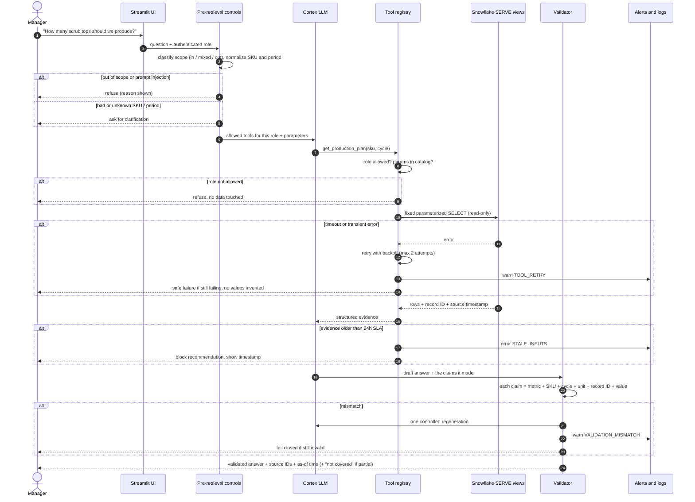
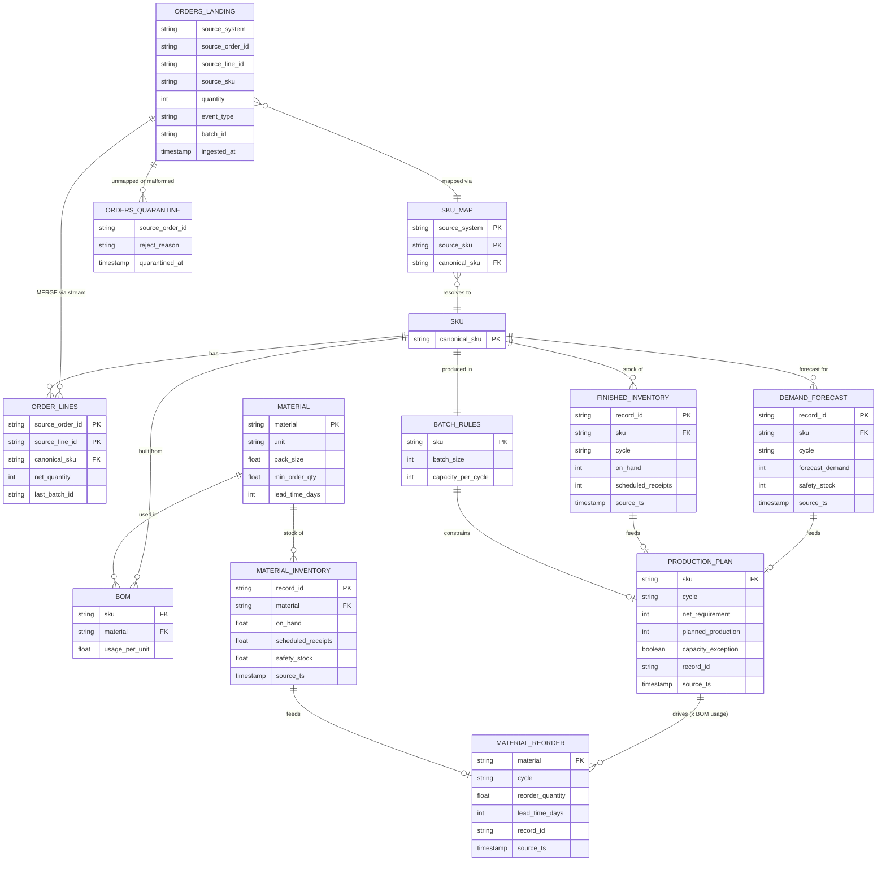

# System architecture

Four views of the same system, from the outside in. All figures are for the design; the prototype in this repo implements the **Serve → Assistant → Evaluation** path locally (sqlite instead of Snowflake, deterministic stand-ins instead of the Cortex LLM).

1. [Component architecture](#1-component-architecture): what the pieces are and where they live
2. [Request lifecycle](#2-request-lifecycle): what happens to one question, step by step
3. [Data model](#3-data-model-entities): the entities and how they relate
4. [Trust boundaries and access](#4-trust-boundaries-and-access): who can touch what

---

## 1. Component architecture

```mermaid
flowchart LR
    subgraph SRC["Source systems"]
        direction TB
        S1["Shopify<br/>orders · cancellations"]
        S2["Hospital B2B orders<br/>Google Sheets"]
        S3["Retailer / vendor files<br/>S3 bucket"]
        S4["Planning inputs<br/>demand forecast · BOM<br/>batch sizes · capacity · lead times"]
    end

    subgraph ING["Ingestion"]
        direction TB
        I1["Fivetran"]
        I2["Scheduled Sheets load"]
        I3["Snowpipe"]
    end

    subgraph SF["Snowflake data platform"]
        direction TB
        RAW[("RAW schema<br/>immutable landing<br/>source IDs · ingested_at · batch_id")]
        MAP["SKU standardization<br/>canonical SKU map · dedup<br/>unit normalization"]
        QUA[("QUARANTINE<br/>unmapped SKUs<br/>malformed records")]
        CHG["Change processing<br/>Streams + Tasks<br/>idempotent MERGE"]
        CUR[("CURATED schema<br/>Dynamic Tables<br/>inventory · replenishment")]
        SERVE[("SERVE schema<br/>read-only views<br/>production_plan · material_reorder")]
        RAW --> MAP --> CHG --> CUR --> SERVE
        MAP -. rejects .-> QUA
    end

    subgraph APP["Assistant application"]
        direction TB
        UI["Streamlit UI<br/>question + authenticated user"]
        PRE["Pre-retrieval controls<br/>authenticate · authorize role<br/>scope class · normalize SKU/period"]
        LLM["Cortex LLM<br/>selects a tool + parameters<br/>and phrases the result"]
        REG["Tool registry<br/>3 allowlisted read-only tools<br/>server-side param validation"]
        GATE["Post-generation validator<br/>claim ↔ record check<br/>qualifiers · freshness"]
        ANS["Answer control<br/>answer · partial · refuse<br/>clarify · safe failure"]
        UI --> PRE --> LLM --> REG
        REG --> LLM
        LLM --> GATE --> ANS --> UI
    end

    DASH["Fallback dashboard<br/>daily validated snapshot<br/>+ as-of timestamp"]

    subgraph OBS["Operations and quality"]
        direction TB
        OPS["Alerts and logs<br/>job failures · freshness SLA<br/>retries · escalation"]
        EVAL["Evaluation loop<br/>automated tests · manual reconciliation<br/>manager feedback · regression suite"]
    end

    S1 --> I1 --> RAW
    S2 --> I2 --> RAW
    S3 --> I3 --> RAW
    S4 --> CUR
    SERVE -- "SELECT only<br/>(role-scoped)" --> REG
    SERVE -- "daily snapshot" --> DASH
    ANS --> OPS
    CHG --> OPS
    ANS --> EVAL
    EVAL -. "new regression cases<br/>logic fixes" .-> CUR
```

Reading the diagram:

- **Everything the user sees is traceable to a SERVE-layer row.** The LLM never sees the raw or curated layers and never writes SQL; it only picks one of three tools.
- **The fallback dashboard hangs off SERVE, not off the chatbot.** If the assistant is down, blocked by validation, or the data is stale, managers still have the last validated snapshot.
- **The evaluation loop feeds back into the pipeline**, not just the chatbot. The V4 fix (batch size and capacity constraints) was a change to the planning SQL found through manager feedback.

---

## 2. Request lifecycle

One question, including the paths where it is stopped.

---

## 3. Data model (entities)

Logical model of the serve layer and what feeds it. Column lists are abbreviated; the synthetic CSVs in `data/synthetic/` show the real shapes used by the prototype.

Every SERVE row carries `record_id` and `source_ts`. Those two columns are what make claim-to-record validation and the freshness SLA possible.

---

## 4. Trust boundaries and access

| Zone | Contents | Who or what can reach it | Control |
|---|---|---|---|
| **Untrusted input** | The user's question text; anything inside it ("ignore previous instructions", raw SQL) | Anyone signed in | Scope classification, injection refusal, parameter validation against the catalog |
| **Model zone** | Cortex LLM | Receives the question and *structured evidence only* | No SQL execution rights; can only choose among 3 allowlisted tools; output treated as untrusted |
| **Tool boundary** | Tool registry | Called by the model | Role-to-tool permission checked **before** any data access; exact parameter set enforced; fixed `SELECT` statements |
| **Data zone** | SERVE views (curated and raw are not exposed) | Assistant service role, `SELECT` only | Role-based access: production role reaches production and inventory views, supply role reaches material views |
| **Output boundary** | Validator and answer control | Everything before display | Nothing is shown unless it passes claim-to-record validation; any exception fails closed |
| **Independent path** | Fallback dashboard | Managers directly | Reads the daily validated snapshot, not chatbot output |

| Role | Tools allowed | Data domain |
|---|---|---|
| `production_manager` | `get_production_plan`, `get_inventory_status` | Finished goods |
| `supply_manager` | `get_material_reorder` | Materials and suppliers |

The role table is enforced in code in [`tools.py`](../src/zaar_assistant/tools.py) (`ROLE_PERMISSIONS`).
